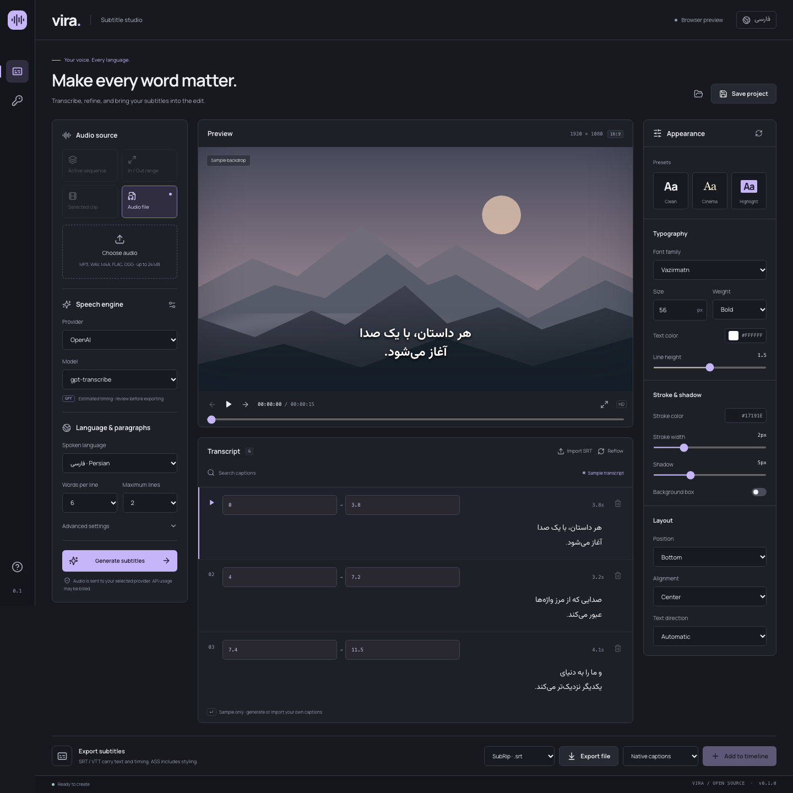

# Vira · ویرا

**A Farsi-first subtitle studio for Adobe Premiere Pro.**

Vira brings transcription, caption editing, and typography into a resizable Premiere panel. English and فارسی interfaces, local audio extraction, your own API keys, and portable subtitle projects. Original source is MIT licensed.



> **Developer preview · v0.1.0.** The browser workflow is tested. Premiere 24.x–26.x on macOS is the compatibility target; in-host acceptance testing is still required. No live paid provider calls have been made during automated verification.

## What it does

- Transcribe the active sequence, sequence In/Out range, selected timeline clip, or an audio file.
- Use **`gpt-transcribe`** (default), GPT-4o transcription models, OpenAI Whisper, Groq Whisper, Deepgram Nova, or an HTTPS OpenAI-compatible endpoint.
- Choose from 22 language settings, including Persian, Arabic, and automatic detection. Availability depends on the selected provider/model.
- Add vocabulary context; `gpt-transcribe` also supports keyword hints and multiple expected input languages.
- Edit caption text and start/end times, search captions, remove/undo, and import SRT.
- Configure words per line, maximum lines, duration, and pause boundaries.
- Preserve Farsi shaping, Unicode bidirectional text, and zero-width non-joiners. Normalize Arabic ی/ک variants and optionally convert digits.
- Control font, weight, size, color, stroke, shadow, background, position, alignment, direction, and preview line spacing.
- Add a native caption track, or render styled transparent PNG overlays onto an empty video track.
- Export SRT, VTT, styled ASS, or save/open a Vira JSON project.

## Run in a browser

Use Node.js 22.12+ (24 LTS recommended).

```bash
npm ci
npm run dev
```

Open the printed local URL. Sample Persian cues and a sample vector backdrop are clearly labeled. Browser mode supports audio-file transcription, editing, and exports; Premiere actions are disabled. Provider calls use browser fetch and depend on that provider's CORS policy. The Premiere panel uses Node HTTPS and does not disable browser security.

## Install the Premiere panel on macOS

Build on the same CPU architecture as your Premiere runtime. FFmpeg's binary matches the OS/CPU running `npm ci`; build separately for Intel and Apple Silicon. CEP is used for compatibility with recent versions rather than requiring the newer UXP DOM.

```bash
npm ci
npm run build
npm run install:cep
```

This installs `release/Vira` at:

```text
~/Library/Application Support/Adobe/CEP/extensions/Vira
```

For this unsigned development build, manually enable Adobe CEP developer mode for your host's runtime version. Adobe documents `com.adobe.CSXS.12 PlayerDebugMode`; some older hosts use CSXS.11:

```bash
defaults write com.adobe.CSXS.12 PlayerDebugMode 1
# Only if your Premiere uses CEP 11:
defaults write com.adobe.CSXS.11 PlayerDebugMode 1
```

Developer mode allows unsigned CEP extensions. This project never changes that setting automatically. Restart Premiere, then open **Window → Extensions → Vira Captions** (the menu may say Extensions (Legacy)). If the host does not expose CEP, this build cannot load; it is not a UXP `.ccx` package. Public signed distribution is a separate release step.

On Windows, build on Windows and copy `release/Vira` to `%APPDATA%\Adobe\CEP\extensions\Vira`; follow Adobe's CEP instructions for unsigned development extensions.

### Timeline audio setup

1. In Premiere's Export workspace, choose **Waveform Audio** with video disabled; save an **audio-only WAV** preset as an `.epr` file.
2. In Vira → Connections, select that preset. This choice lasts for the panel session.
3. Choose Active sequence or In/Out range. Vira exports the sequence mix with Premiere's effects/mutes, then converts it locally to mono 16 kHz MP3 before upload.
4. For Selected clip, select one audio clip or a linked audio/video pair. FFmpeg extracts the underlying media using clip In/Out and preserves its timeline offset. This path does **not** render timeline effects, gain, or remapping. Use a sequence range for the actual processed mix. Retimed, reversed, nested, and offline clips require the sequence route.

Synchronous Premiere export can block the host and cannot be canceled mid-export. FFmpeg extraction and network requests can be canceled. Temporary extracted audio is removed after reading. Imported SRT/PNG assets are retained in `~/Documents/Vira Captions` because Premiere references them.

## Choose timing deliberately

| Model                                                           | Timing in Vira                                                 |
| --------------------------------------------------------------- | -------------------------------------------------------------- |
| `gpt-transcribe`, `gpt-4o-transcribe`, `gpt-4o-mini-transcribe` | Estimated across the recording; review every cue               |
| `gpt-4o-transcribe-diarize`                                     | Native segment boundaries; estimated words within each segment |
| OpenAI `whisper-1`, Groq Whisper, Deepgram                      | Provider word timestamps when returned                         |
| Custom endpoint                                                 | Word timestamps when supplied; otherwise estimated             |

GPT transcription does not provide forced alignment. Vira does not silently make a second paid alignment call. Long silence makes duration-based timing especially approximate. Reflow uses current cue boundaries to estimate word positions and is labeled accordingly. Use Whisper/Deepgram for timestamped captions, or correct GPT times manually.

Uploads are limited to 24 MiB. Larger timeline exports need a shorter In/Out range; automatic multi-request chunking is not implemented. Generation makes one request, with no hidden retries. Provider/model access, pricing, supported languages, and quota belong to the provider.

## Styling and output

**Native captions:** SRT is imported as a caption track. Its text and timing are editable in Premiere; style it with Premiere's track controls. SRT/VTT do not preserve Vira's typography.

**Styled overlays:** Vira renders transparent PNG images with browser text shaping. Font, stroke, color, shadow, box, alignment, and position are embedded in those images. Add an empty, visible, unlocked video track above your footage, choose Styled overlays, then Add to timeline. The sequence must use square pixels. Text stays editable in Vira; reimport changed overlays onto a new empty track. These are raster image clips, not editable Essential Graphics text or a proprietary MOGRT. If insertion fails, Vira removes clips inserted into that initially empty track; imported bin assets can remain.

**ASS:** carries font, size, weight, fill, stroke, shadow, box, position, and alignment. A compatible external renderer and installed fonts are required. Renderer-specific bidi shaping can vary. Direction and line-height sliders control the preview and PNG output; ASS line height is renderer-owned. Install the [Vazirmatn font](https://github.com/rastikerdar/vazirmatn) on the target system for matching ASS output. PNGs use the bundled font, so they need no system font installation.

The scenic preview is a labeled **sample backdrop**, not live Premiere footage. File-audio preview plays the loaded source; timeline preview currently shows caption timing without live timeline monitoring.

## API keys and privacy

Keys are masked and held in React memory, separately per provider, until the panel closes/reloads. They are never placed in localStorage, logs, URLs, or project files. Projects store cues, styling, paragraph rules, and optional sequence identity; they do not include keys, audio, prompts, or endpoints. Only Generate uploads your chosen audio. Custom endpoints receive your key/audio, require HTTPS, and should only be services you trust. Responses are size-bounded in CEP; errors never echo remote response bodies. No analytics, backend service, automatic uploads, or subscription.

## Code map

```text
src/App.tsx                    Application state and editing workflows
src/components/Controls.tsx   Shared accessible native controls
src/components/AppearancePanel.tsx  Typography inspector
src/components/TranscriptPanel.tsx  Caption editing and search
src/components/Guide.tsx       Bilingual usage guide
src/lib/captions.ts           Persian normalization, grouping, SRT/VTT/ASS
src/lib/providers.ts          Provider-specific request/response adapters
src/lib/transport.ts          Browser fetch / CEP Node HTTPS
src/lib/premiere.ts           Typed panel-to-host bridge and local audio work
src/lib/render.ts             Transparent caption PNG rendering
src/lib/project.ts            Validate untrusted project imports
src/lib/i18n.ts               English/Persian UI copy
cep/host/index.jsx            Small ES3-compatible Premiere adapter
cep/CSXS/manifest.xml         CEP host compatibility and panel registration
scripts/                      Build packaging and macOS installation
```

React + TypeScript + Vite, with small pure subtitle functions and a separate host adapter. No server and no state-management framework.

## Verification

```bash
npm run format:check
npm run typecheck
npm test
npx playwright install chromium
npm run test:e2e
npm run build
npm audit
```

Tests cover Persian/ZWNJ preservation, serialization, segmentation, invalid timing, project validation, provider request contracts, key handling, canceled/failed/successful transcription, RTL/narrow layouts, downloads, and automated accessibility. Provider calls are mocked. See [manual acceptance checks](docs/ACCEPTANCE.md) before marking any Premiere version supported.

## Contributing

See [CONTRIBUTING.md](CONTRIBUTING.md), [DESIGN.md](DESIGN.md), and [UX-CONTRACT.md](UX-CONTRACT.md). Report provider/model and Premiere version with a reproducible issue; never include API keys or private audio. No telemetry is collected by Vira.

## License and dependencies

Vira's original source is [MIT](LICENSE). Font, icon, framework, and FFmpeg licenses remain separate; see [THIRD_PARTY_NOTICES.md](THIRD_PARTY_NOTICES.md). Local extension packages include FFmpeg's license/readme and font license files. FFmpeg is executed as a separate local process. Do not redistribute a built binary package without satisfying the corresponding FFmpeg license/source obligations.

## References

- [OpenAI file transcription](https://developers.openai.com/api/docs/guides/speech-to-text) and [gpt-transcribe](https://developers.openai.com/api/docs/models/gpt-transcribe)
- [Groq speech to text](https://console.groq.com/docs/speech-to-text)
- [Deepgram models and languages](https://developers.deepgram.com/docs/models-languages-overview/)
- [Adobe CEP resources](https://github.com/Adobe-CEP/CEP-Resources) and [Premiere sample panel](https://github.com/Adobe-CEP/Samples/tree/master/PProPanel)
- [Premiere sequence scripting reference](https://ppro-scripting.docsforadobe.dev/sequence/sequence/)
